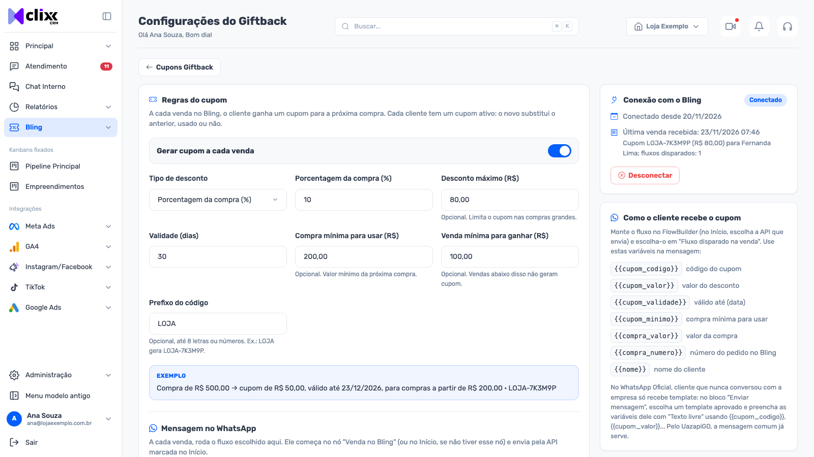

# Bling — Cupons Giftback

O aplicativo **Clixx CRM** conecta sua conta Bling ao Clixx. A cada venda registrada no Bling, o cliente ganha um **cupom Giftback** para a próxima compra e recebe a mensagem no **WhatsApp**. No Clixx você acompanha os cupons, dá baixa quando o cliente usa e vê as **Métricas de vendas** (receita, ticket médio, retorno, receita gerada pelo Giftback e a matriz RFM dos clientes).

## Passos no Bling

1. Acesse sua conta Bling.
2. Abra o menu **Central de Extensões**.
3. Pesquise por **Clixx CRM**.
4. Clique em **Instalar aplicativo**.
5. Clique em **Autorizar**.

Pronto: todas as configurações no Bling estão finalizadas.

## Passos no Clixx CRM

### Requisitos

**É obrigatório ter conta no Clixx CRM antes de instalar?**
Sim. Crie sua conta em [app.clixx.com.br/cadastro](https://app.clixx.com.br/cadastro).

**O que preparar antes de autorizar?**

* Entre no Clixx CRM, **no mesmo navegador**, com um usuário **Administrador**. Depois de autorizar, o Bling devolve você para o Clixx e a conexão é concluída na hora.
* Para o cliente receber o cupom no WhatsApp, deixe um WhatsApp conectado em **Canais / Sessões** no Clixx.
* Confira se os contatos no Bling têm o **celular** preenchido: é para ele que a mensagem vai.

**O que fazer depois de autorizar?**

1. No Bling, na página do aplicativo instalado, em **Configuração de webhooks**, ative **Pedidos de Vendas**. É esse aviso que informa o Clixx a cada venda.
2. No Clixx, abra **Bling → Configurações do Giftback**, ligue **Gerar cupom a cada venda** e defina as regras: valor fixo ou porcentagem da compra, validade, compra mínima para usar e venda mínima para ganhar.

   
3. Para enviar o cupom no WhatsApp, monte um fluxo no **FlowBuilder** com o gatilho **Venda no Bling** e escolha-o em **Fluxo disparado na venda**. No WhatsApp Oficial, use um template aprovado: a tela de Configurações do Giftback traz um modelo pronto.

A partir daí, cada venda no Bling gera um cupom. As vendas dos últimos 12 meses são importadas para **Bling → Métricas de vendas** em alguns minutos.


O cupom é controlado pelo Clixx: o Bling só avisa as vendas. Para dar baixa, abra **Bling → Cupons Giftback**, procure pelo código, nome, telefone ou número do pedido e clique em **Dar baixa**.


### Contato

* E-mail: [suporte@clixx.com.br](mailto:suporte@clixx.com.br)
* WhatsApp: +55 45 98822-8859
